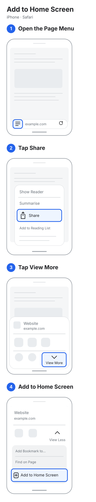

# PWA Instructions

Reusable instructions for installing web apps: one simple SVG and a matching text guide for each installation layout. The artwork is generic, with highlighted buttons and no host-app branding.

[Try the React example](https://npomfret.github.io/pwa-instructions/) · [API reference](docs/api.md) · [Example source](examples/react)



## Packages

| Package | Responsibility |
| --- | --- |
| [`@pwa-instructions/core`](packages/core) | Guide data, SVGs, text, browser detection and selection. No framework dependency. |
| [`@pwa-instructions/react`](packages/react) | Unstyled React components using the core. |
| [`examples/react`](examples/react) | A client-only demo with guide selection, a domain preview and image/text choices. |

Future framework adapters can live beside React under `packages/` and consume the same core. Plain JavaScript apps can already use the core directly. These are the planned package names; publication to npm is pending.

```jsx
import { InstallInstructions } from '@pwa-instructions/react';

<InstallInstructions
  presentation="both"
  siteUrl="https://your-domain.com"
  fallback={<p>Choose a guide for your browser.</p>}
/>
```

Leave `guideId` out for automatic browser detection. Use `guideId="ios-safari-iphone-layout-1"` for explicit selection. For your own interface, call `selectGuide(detectBrowserEnvironment())` from the core and use the returned steps and illustration URL. The [API reference](docs/api.md) describes the props, defaults and selection results.

## Development

Requires Node.js 22.12 or newer.

```sh
npm ci
npm run dev
```

`npm run check` builds both packages and the example, checks its types, then runs tests serially with one worker. `npm run pack:packages` produces local npm archives. No original screenshots are included in the packages.

The GitHub Actions workflow checks changes and deploys the example to GitHub Pages from `main`. The static output is `examples/react/dist/`.

## Layouts and versions

Version the **layout**, independently of browser and OS releases. Each immutable layout has its own folder:

```text
guides/
  ios/safari/iphone/
    layout-1/
      metadata.json
      install.svg
      instructions.md
    # layout-2/ is added when the installation controls change
```

[The first layout](guides/ios/safari/iphone/layout-1/metadata.json) records iOS 27 and Safari 27 on iPhone, as reported by the source owner. Its compatibility ranges begin there and remain open until another layout supersedes it. Newer versions reuse the latest applicable layout; this is reported as a fallback, not new device verification. Earlier versions are not assumed to match. Add another layout rather than replacing the old artwork when important controls change.

`catalog.json` indexes the layouts. The build packages their metadata, SVGs and Markdown, and generates the data consumed by both core and React. Text is complete on its own, with the same step numbers as the SVG. The iPhone flows stop at **Add to Home Screen**; their final confirmation is described in text but not illustrated. The Mac Safari flow includes its Add confirmation; Mac Chrome includes installation and Show in Finder.

The iPhone SVGs use a single vertical column. Its step titles are short, the target controls have blue outlines, and unrelated menu text is muted. Detailed descriptions stay in the Markdown file and structured step data.

## Detection and manual selection

Guides currently cover iPhone Safari, iPhone Brave via Safari, iPhone Chrome, Mac Safari, Mac Chrome, Android Chrome, Windows Chrome, and Windows Edge. Unsupported browsers and devices receive no substitute guide. The host app can supply an explicit guide ID or its own environment data.

Detection is a best-effort hint: browsers can disguise their identity. Safari 26+ freezes the OS version in its user-agent string, so the selector can use the Safari version when the real iOS version is hidden. [WebKit explains the change.](https://webkit.org/blog/17333/webkit-features-in-safari-26-0/) A manual choice should remain available.

The React component detects after mounting, supports server rendering, and offers image, text or combined presentation. Its optional `siteUrl` prop puts your domain into the SVG address bars; the default is `example.com`. Paths, credentials and query strings are omitted. The illustration appears below a single descriptive heading, separate from the controls and text. Guide images are self-contained data URLs by default; a hosted URL can be supplied where Content Security Policy requires one. Selection and rendering make no network requests.

Android Chrome and both Windows guides are based on current official documentation, with no tested versions claimed. Their headings say “Documentation draft”; automatic selection returns `match: "documentation"` with an explicit verification note. Version-specific recorded guides take priority. Their observed versions and compatibility ranges are `null` until device evidence is available.

## Source references and future coverage

Original references live under `source-images/<os>-<major>/<browser>-<major>/<device>/`, with a metadata file describing versions and ordered actions. [The first set](source-images/ios-27/safari-27/iphone/metadata.json) contains the four supplied screenshots. Originals contain app branding and share-sheet contacts; reusable artwork omits them.

Current reference versions are iOS 27 / Safari 27, Brave 1.97 and Chrome 157.0.8103.24, plus macOS Golden Gate 27.0.1 / Safari 27.0.1 and Mac Chrome 156.0.8078.73. The Mac Chrome and macOS versions were read from the source owner's computer; its screenshots show the controls but do not display versions. The browser major version is normally sufficient for matching; Brave additionally records a 1.97 minimum because its major version remains 1 across many releases. If Brave hides the necessary browser or OS details, choose the guide manually.

| Guide | Route | Steps |
| --- | --- | --- |
| iPhone Safari | Page Menu → Share → View More → Add to Home Screen | 4 |
| iPhone Brave | Share → View More → Open in Safari, then the Safari sequence | 7 |
| iPhone Chrome | Share in the top address bar → View More → Add to Home Screen | 3 |
| Mac Safari | File → Add to Dock → Add | 3 |
| Mac Chrome | More → Cast, save and share → Install → Next → Install → Show in Finder | 6 |
| Android Chrome (documentation draft) | More → Install and create shortcut → Install | 3 |
| Windows Chrome (documentation draft) | More → Cast, save and share → Install → Install | 4 |
| Windows Edge (documentation draft) | Settings and more → More tools → Apps → Install this site as an app → Install | 5 |

Brave and Chrome share identical step text and artwork by reference. Brave reuses the complete Safari continuation. Chrome keeps its own Add to Home Screen drawing because the item appears in a different menu group. The build assembles one standalone SVG and one Markdown document per journey, with consecutive numbering. See [authoring and reuse](docs/authoring-guides.md).

The [Brave research note](docs/research/brave-ios.md) explains its Safari handoff. The Mac Safari guide is based on [Apple's documented Add to Dock flow](https://support.apple.com/en-ie/104996); device versions were supplied by the owner, but Safari screenshots have not been supplied yet. The Mac Chrome guide follows [six supplied screenshots](source-images/macos-27/chrome-156/desktop/metadata.json) and includes reopening from `chrome://apps`, as confirmed by the owner and [Google's web app documentation](https://support.google.com/chrome/answer/9658361?co=GENIE.Platform%3DDesktop&hl=en). The [Android and Windows research note](docs/research/android-and-windows.md) records current vendor sources, older wording variations and the device verification still needed.

## License

Project code, authored instructions and SVG artwork are available under the [MIT License](LICENSE). Source screenshots are reference material and may contain third-party content.
